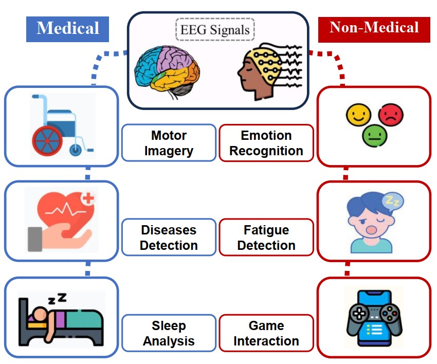
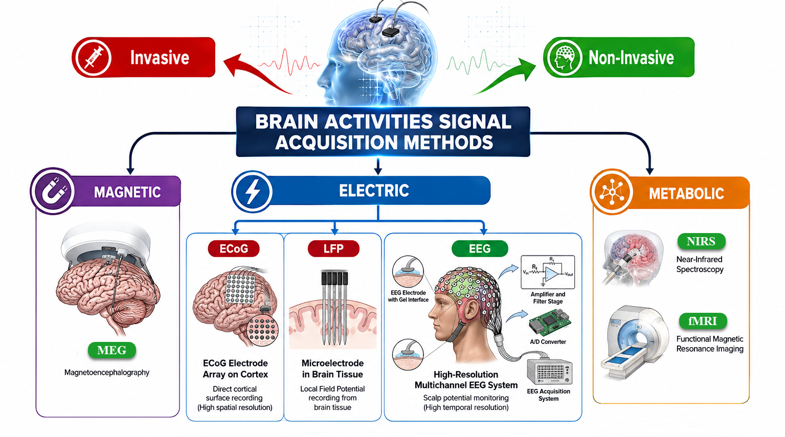
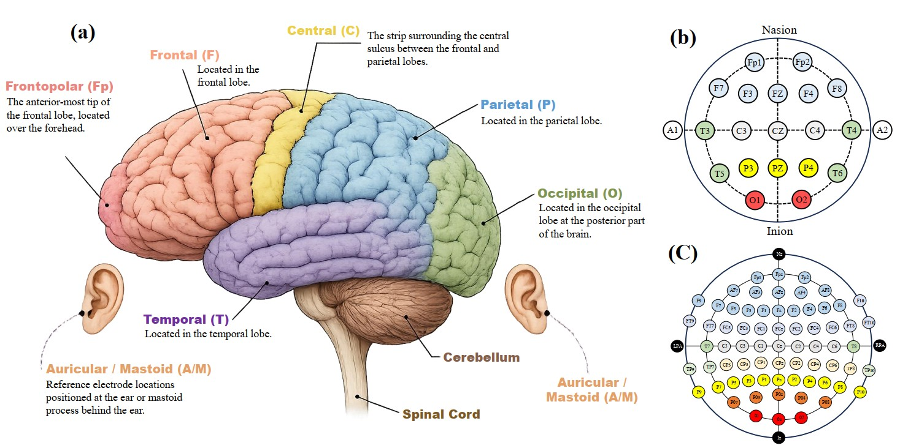
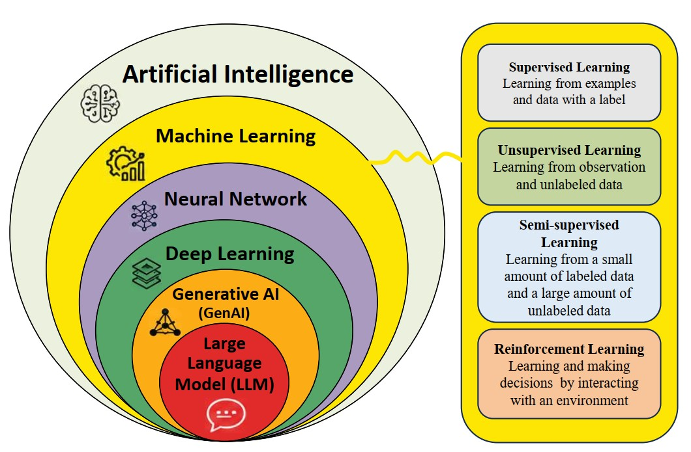
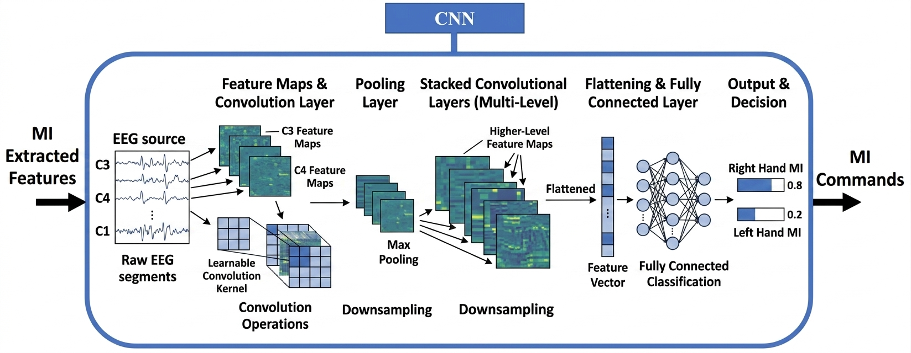
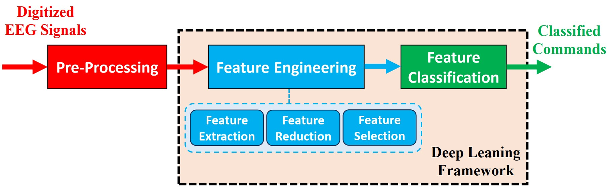
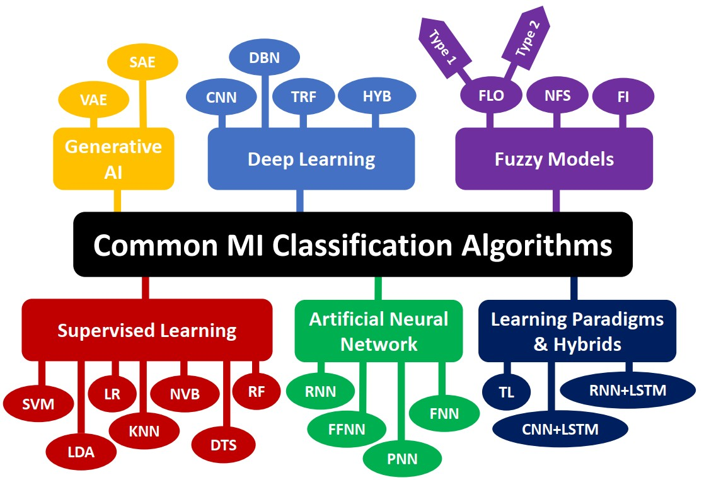
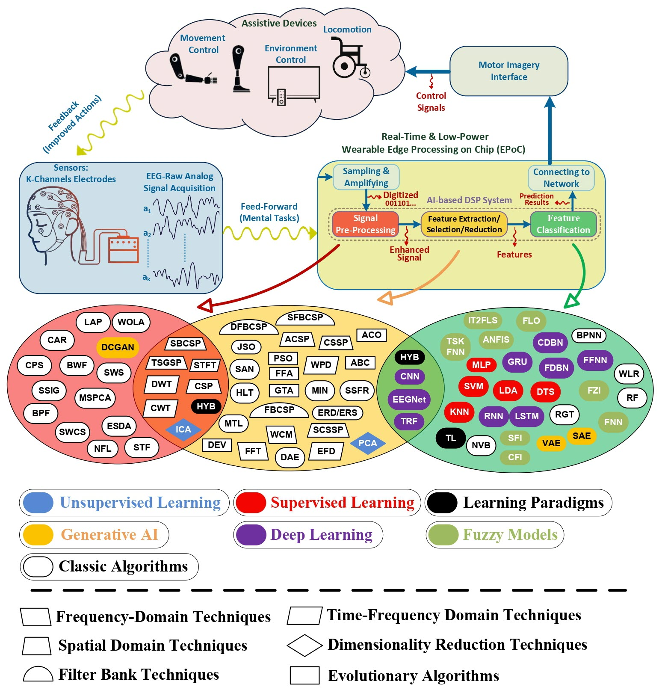
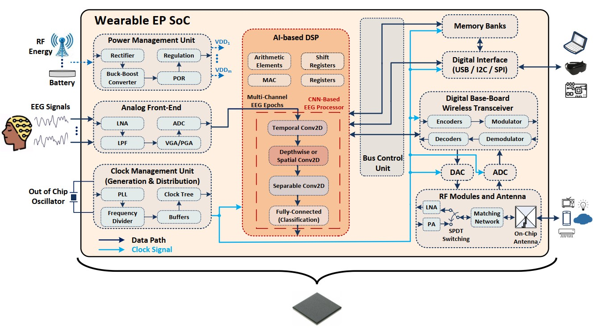
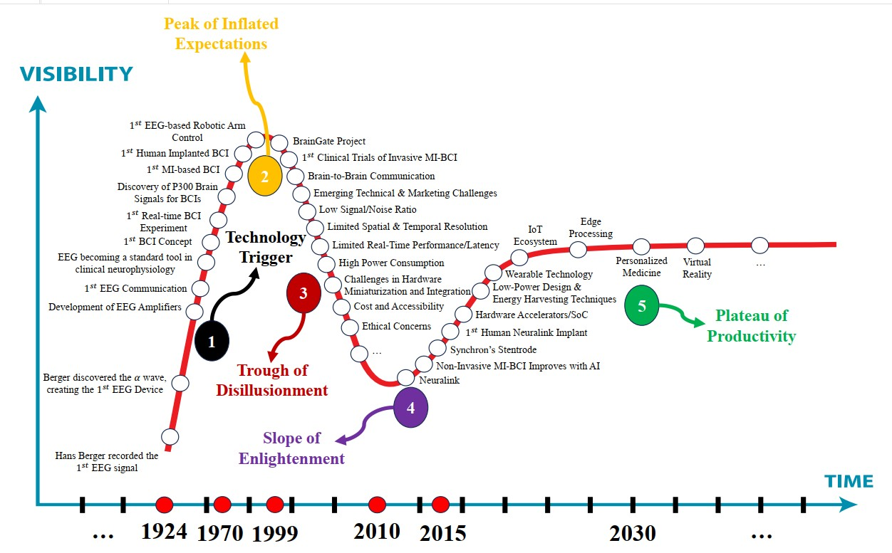

# EEG-Based Motor Imagery BCI Algorithms and Technologies: A Review

**A comprehensive review of signal-processing algorithms, hardware platforms, and emerging technologies for EEG-based motor imagery brain–computer interfaces.**

**Manuscript status:** Preprint — submitted to *IEEE Access* for consideration.

[Read the preprint (PDF)](./BCI_Review_arXiv_preview.pdf) · [Author's GitHub profile](https://github.com/mhkghamsari)

> **arXiv link:** Add the verified arXiv abstract URL here when available.  
> This README describes the uploaded preprint; it does not claim that the manuscript has been accepted or published by IEEE.

## Authors

- **Mohammad Hossein Koohi Ghamsari** — Sharif University of Technology
- **Seyede Fatemeh Ghamkhari** — KTH Royal Institute of Technology
- **Siavash Bayat** — Sharif University of Technology
- **Ahmed Hemani** — KTH Royal Institute of Technology

## Overview

Electroencephalography (EEG)-based motor imagery brain–computer interfaces (MI-BCIs) translate imagined movements into commands for external devices without requiring physical movement. Their potential applications include assistive technologies, neuroprosthetics, and motor rehabilitation.

This review brings together the **software and hardware perspectives** of MI-BCI development. It examines the complete signal-processing pipeline, benchmark datasets, classical and AI-based decoding algorithms, embedded implementations, and technologies that could support more practical wearable and real-time systems.

The paper also discusses a **conceptual next-generation wearable, edge-processing MI-BCI system-on-chip (SoC) architecture**. This is a proposed framework, *not* a fabricated or quantitatively validated chip.

## Topics Covered

| Area | Coverage |
| --- | --- |
| MI-BCI fundamentals | EEG acquisition, sensorimotor rhythms, motor imagery, system architecture, and feedback |
| Signal processing | Preprocessing, artifact removal, feature extraction/selection, and classification |
| AI-based decoding | Machine learning, deep learning, CNNs, recurrent models, transformers, and related approaches |
| Benchmarking | Public MI datasets, evaluation protocols, and reported performance metrics |
| Hardware | Embedded implementations, SoCs, ASICs, FPGAs, hardware accelerators, and low-power design |
| Converging technologies | Wearable EEG, edge processing, IoT, energy harvesting, and AR/VR |
| Open challenges | Signal quality, non-stationarity, cross-subject generalization, calibration, latency, cost, and usability |

## Illustrated Guide to the Review

The figures below provide a visual introduction to the paper's background, EEG signal processing, AI-based decoding, and next-generation system concepts. The final figure is a **supplementary Gartner-inspired conceptual illustration** supplied separately from the uploaded preprint; it should not be interpreted as an established maturity assessment or a prediction of adoption.

### 1. Applications of EEG-based BCIs

<p align="center"></p>

*Overview of medical applications—including motor imagery, disease-related assessment, and sleep analysis—and non-medical applications such as emotion recognition, fatigue detection, and game interaction.*

### 2. Brain-signal acquisition methods

<p align="center"></p>

*Comparison of magnetic, electrical, and metabolic signal acquisition, including MEG, ECoG, local field potentials (LFP), scalp EEG, NIRS, and fMRI. The diagram distinguishes invasive from non-invasive approaches.*

### 3. Brain regions and EEG electrode placement

<p align="center"></p>

*Illustration of cortical regions and the international 10–20 and 10–10 EEG electrode placement systems, providing anatomical context for sensorimotor recordings.*

### 4. Artificial intelligence and learning paradigms

<p align="center"></p>

*Schematic overview of AI-related concepts, including machine learning, neural networks, deep learning, generative AI, and large language models, alongside supervised, unsupervised, semi-supervised, and reinforcement learning.*

### 5. CNN-based motor imagery decoding

<p align="center"></p>

*Illustrative convolutional neural network (CNN) pipeline: EEG input, learned feature maps, pooling and stacked convolutions, feature flattening, and fully connected classification into motor-imagery commands.*

### 6. EEG signal-processing workflow

<p align="center"></p>

*General decoding workflow from digitized EEG through preprocessing, feature engineering (extraction, reduction, and selection), and classification to predicted motor commands.*

### 7. Families of MI classification algorithms

<p align="center"></p>

*Taxonomy of classification methods reviewed in the paper, including classical supervised learning, neural-network models, deep learning, generative approaches, fuzzy models, transfer learning, and hybrid architectures.*

### 8. Integrated MI-BCI processing pipeline and algorithm landscape

<p align="center"></p>

*End-to-end view from EEG acquisition and wearable edge processing to assistive-device control and feedback. The diagram also groups representative preprocessing, feature-engineering, and classification approaches.*

### 9. Conceptual wearable edge-processing SoC architecture

<p align="center"></p>

*Proposed system-level integration of EEG analog front-end, AI-based digital signal processing, memory, clock and power management, digital interfaces, wireless communication, and RF circuitry. This is a conceptual design, not a fabricated or quantitatively validated chip.*

### Supplementary Perspective: Gartner-Inspired BCI Development Cycle

### 10. Gartner-inspired illustration of BCI development

<p align="center"></p>

*An illustrative, author-proposed analogy for the historical development of EEG-based BCI and motor imagery technologies. It is not an official Gartner assessment or an empirically validated technology forecast.*

The five phases depicted in this illustration summarize the narrative proposed for EEG-based BCI and motor imagery research:

1. **Technology Trigger:** From the early EEG foundations of the 1920s to device-control experiments, the emergence of the BCI concept, and P300-based communication research.
2. **Peak of Inflated Expectations:** Advances in robotic control, implanted interfaces, and brain-to-brain demonstrations drew wider attention while practical barriers remained.
3. **Trough of Disillusionment:** Low signal-to-noise ratio, limited spatial resolution, high power consumption, calibration burden, usability, and privacy concerns constrained real-world translation.
4. **Slope of Enlightenment:** AI-based decoding, low-power SoC and edge hardware, IoT connectivity, and immersive training environments opened further research pathways.
5. **Plateau of Productivity:** A proposed direction toward personalized, efficient, wearable MI-BCIs integrated with rehabilitation and connected systems—**not a claim that these applications have already reached widespread adoption**.

*Note: This is an interpretive research illustration rather than a quantitative trend analysis or an official Gartner Hype Cycle. Its final stage describes a possible direction, not an established outcome.*

## Review Methodology

The literature search covered **January 1, 2014–July 1, 2026**, using IEEE Xplore, PubMed, ScienceOpen, Semantic Scholar, Scopus, Web of Science, and Google Scholar.

The manuscript reports the following screening process:

| Stage | Number of studies |
| --- | ---: |
| Unique records after deduplication | 1,247 |
| Excluded during title/abstract screening | 349 |
| Full texts assessed | 898 |
| Excluded after full-text assessment | 152 |
| Eligible studies in the literature corpus | 746 |
| Selected for detailed analysis in this preprint | 324 |

Search strings, eligibility criteria, screening, quality assessment, and data-extraction procedures are provided in **Section II** of the paper.

## Paper Organization

1. **Introduction** — Motivation and scope of EEG-based MI-BCI research.
2. **Review Methodology** — Research questions, search strategy, and study selection.
3. **BCI Modalities** — Electrical, magnetic, and metabolic approaches.
4. **EEG-Based MI-BCI Systems** — Principles, acquisition, processing, and feedback.
5. **MI-BCI Signal Processing Algorithms** — Classical and AI-based software methods and hardware implementations.
6. **Converging Technologies** — Wearable devices, embedded/edge systems, connectivity, and immersive technologies.
7. **Proposed Next-Generation System** — Conceptual MI-BCI architecture and integrated processing framework.
8. **Discussions** — Synthesis of findings, challenges, and potential solutions.
9. **Conclusion** — Research directions for practical MI-BCI systems.

## Repository Contents

```text
.
├── README.md
├── BCI_Review_arXiv_preview.pdf
└── Figures/
    ├── Fig_EEG-based_BCI_App.jpg
    ├── Fig_BCI_Methods.png
    ├── Fig_Electrodes_Systems.jpg
    ├── Fig_AI_Algorithms_Domains.jpg
    ├── Fig_CNN.png
    ├── Fig_Conventional_DL_Processing.jpg
    ├── Fig_Feature_Classification_Classes.jpg
    ├── Fig_Signal_Processing_Pipeline_Algorithms_page-0001.jpg
    ├── Fig_edge_processing_BCI_chip.jpg
    └── Fig_Gartnerhypecycle.jpg
```

This is a **paper repository**, not an implementation repository. The uploaded manuscript is a literature review; this repository does not currently provide executable code, trained models, experimental datasets, or a validated SoC implementation.

## Citation

If this review supports your research, please cite the preprint or its eventual published version. Update the citation below when a verified arXiv identifier, DOI, or final publication record becomes available.

```bibtex
@misc{koohighamsari2026eeg,
  author = {Koohi Ghamsari, Mohammad Hossein and
            Ghamkhari, Seyede Fatemeh and
            Bayat, Siavash and
            Hemani, Ahmed},
  title  = {EEG-Based Motor Imagery BCI Algorithms and Technologies: A Review},
  year   = {2026},
  note   = {Preprint submitted to IEEE Access}
}
```

## Manuscript and Reuse Notice

The paper is shared here for scholarly access and citation. The manuscript, its figures, and other included materials remain subject to the applicable author and/or publisher rights. **Do not assume that a software license such as MIT automatically applies to the paper PDF.** Any redistribution should comply with the applicable permissions and publication terms.

---

**Maintained by:** [Mohammad Hossein Koohi Ghamsari](https://github.com/mhkghamsari)
